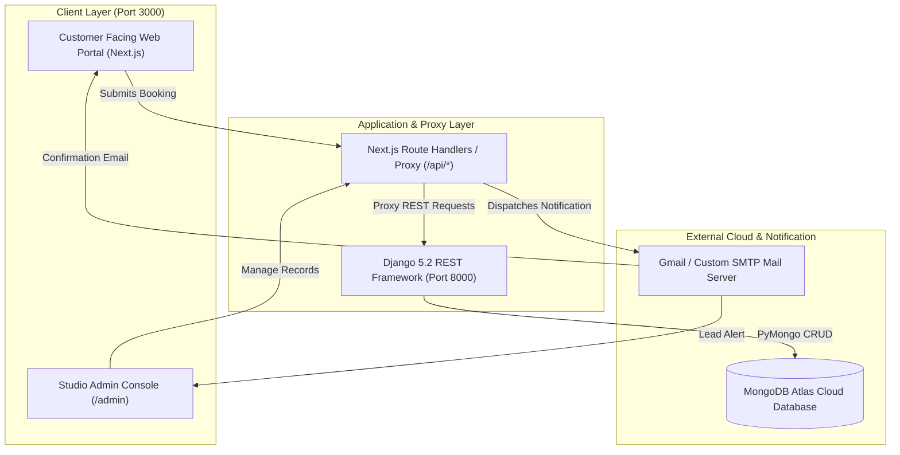

# Software Requirements Specification (SRS)
## Detailing Street Ludhiana — Automotive Care & Detailing Management System

---

### Document Control
- **Project Title:** Detailing Street Ludhiana Automotive Care & Management Platform
- **Document Version:** 1.0.0
- **Document Standard:** IEEE Std 830-1998 Format
- **Date:** November 2026
- **Status:** Approved / Active

---

## 1. Introduction

### 1.1 Purpose
The purpose of this Software Requirements Specification (SRS) document is to provide a complete, formal description of the **Detailing Street Ludhiana** software system. It specifies the functional requirements, non-functional constraints, system architecture, database design, API interfaces, and user workflows for both the customer-facing digital studio portal and the administrative enterprise management console.

### 1.2 Document Conventions
This specification conforms to the IEEE Std 830-1998 guidelines for SRS documents.
- **Requirement Identifiers:** Functional requirements are prefixed with `FR-`, followed by the category code and sequential numbering (e.g., `FR-BK-001`).
- **Non-Functional Identifiers:** Non-functional requirements are prefixed with `NFR-` (e.g., `NFR-SEC-001`).
- **Priority Indicators:** High, Medium, Low.

### 1.3 Intended Audience
- **Academic Evaluators & Instructors:** For verifying technical implementation of Django backend services, REST API architectures, and data persistence layers.
- **Software Engineers & Developers:** For feature expansion, maintenance, and system refactoring.
- **Quality Assurance & Testers:** For verifying functional compliance, test case drafting, and security boundary audits.
- **Business Stakeholders & Studio Operators:** For assessing digital booking workflows, customer tracking, and studio operations.

### 1.4 Project Scope
The system represents a decoupled full-stack automotive detailing platform built for high-performance presentation, appointment scheduling, and studio business administration. It encompasses:
1. **Public Presentation & Brand Showcase:** GPU-accelerated parallax hero, service breakdown, dynamic gallery, and real customer proof.
2. **Online Booking Engine:** Automated appointment dispatching with validation, sanitization, rate limiting, and unique booking identifier generation.
3. **Django REST Backend Layer:** Python/Django backend handling business logic and PyMongo-driven cloud database operations.
4. **Cloud Database Layer:** Managed MongoDB Atlas document storage with zero static seed dependencies.
5. **Administrative Management Console (`/admin`):** Unified dashboard for monitoring metrics, changing appointment statuses, maintaining customer directories, registering client vehicles, and modifying service catalogs.
6. **Automated Notification Subsystem:** SMTP-driven email engine delivering branded confirmations to customers and real-time alert dispatches to studio management.

---

## 2. Overall Description

### 2.1 Product Perspective & Architectural Model
The software operates on a modern **Decoupled (Headless) Client-Server Architecture**. The frontend client is built with Next.js (React) and communicates via JSON over HTTP with a Python Django REST API backend service, which directly orchestrates persistence with MongoDB Atlas.



### 2.2 User Classes and Personas
1. **Unauthenticated Public Visitor (Customer):**
   - Accesses studio service details, gallery showcases, and location data.
   - Submits appointment booking requests without requiring an account.
   - Receives automated email confirmations and status updates.
2. **Studio Receptionist / Service Advisor:**
   - Monitors pending booking requests in the admin console.
   - Contacts clients and updates appointments to `Confirmed`, `Completed`, or `Cancelled`.
   - Adds new customers and associates vehicles.
3. **Studio Owner / Administrator:**
   - Full access to revenue metrics, performance indicators, and lead tracking.
   - Manages service catalog offerings, price lists, and operational configurations.
   - Receives real-time lead notification emails.

### 2.3 Operating Environment
- **Client Platforms:** Modern web browsers (Google Chrome 115+, Mozilla Firefox 115+, Apple Safari 16+, Microsoft Edge 115+) on Desktop, Tablet, and Mobile viewports.
- **Runtime Environment (Frontend):** Node.js 20.x / 22.x LTS.
- **Runtime Environment (Backend):** Python 3.12.x / 3.13.x.
- **Cloud Database:** MongoDB Atlas (MongoDB Server 7.0+).
- **Communication Protocol:** HTTPS / HTTP/1.1 & HTTP/2, TLS 1.3, SMTP over TLS (Port 587 / 465).

### 2.4 Design and Implementation Constraints
- **Framework Segregation:** Django handles data modeling, validation, and REST API processing; Next.js serves client pages and handles edge rendering.
- **Port Harmony:** The public portal and the admin console share a single domain/port (`:3000`) while routing `/admin` internally to bypass customer navigation overlays.
- **Security Constraints:** Secrets (database connection strings, SMTP passwords) are strictly sequestered in environment variables and excluded from version control.

---

## 3. System Features & Functional Requirements

### 3.1 Public Portal & Showcase Subsystem
- **FR-PUB-001 (Hero Presentation):** System shall render a GPU-composited video background with requestAnimationFrame-throttled parallax reaction to cursor and scroll movement.
- **FR-PUB-002 (Catalog Display):** System shall display available detailing packages (PPF, Ceramic Coating, Washing, Accessories, Coloured Wraps, Borophene, Tinting) with descriptive features.
- **FR-PUB-003 (Portfolio Showcase):** System shall provide interactive portfolio tabs with a media lightbox capable of displaying high-definition photos and on-demand video reels without automatic bandwidth consumption.
- **FR-PUB-004 (Proof & Reviews):** System shall display authenticated Google Business reviews with star ratings and direct external redirection links.

### 3.2 Appointment Booking Engine
- **FR-BK-001 (Form Inputs):** System shall collect Customer Full Name, Mobile Phone Number, Optional Email Address, Car Model, Target Service, Preferred Date, Preferred Time, and Special Requests.
- **FR-BK-002 (Sanitization & Validation):** System shall sanitize text inputs to strip script/HTML tags, validate 10-digit Indian mobile numbers (`/^[6-9]\d{9}$/`), and enforce future date selection.
- **FR-BK-003 (Rate Limiting):** System shall limit booking submissions from a single IP to a maximum of 10 requests per 15-minute window (`429 Too Many Requests`).
- **FR-BK-004 (Unique Identifier Generation):** System shall generate unique reference IDs adhering to the pattern `DS-YYYYMMDD-XXXXXX`.
- **FR-BK-005 (Persistence):** System shall transmit validated appointments to the Django backend for storage in MongoDB Atlas under the `appointments` collection with initial status `Pending`.

### 3.3 Administrative Management Console (`/admin`)
- **FR-ADM-001 (Route Isolation):** System shall render the `/admin` hierarchy in a dedicated workspace layout, stripping public customer navigation headers, footers, and floating contact buttons.
- **FR-ADM-002 (Executive Metrics):** System shall aggregate and display real-time counts for Total Bookings, Pending Requests, Completed Jobs, Gross Revenue, Registered Customers, Vehicles, and Services.
- **FR-ADM-003 (Appointment Lifecycle Management):** System shall allow administrators to filter appointments by status (`Pending`, `Confirmed`, `Completed`, `Cancelled`), execute substring search, alter statuses via dropdowns, and delete records.
- **FR-ADM-004 (Customer Directory):** System shall support CRUD operations on customer documents including name, contact details, total visits, and membership tier classification (`New`, `Regular`, `VIP`).
- **FR-ADM-005 (Fleet & Vehicle Registry):** System shall maintain vehicle documents identified by registration number, make, model, type, and associated customer owner.
- **FR-ADM-006 (Service Catalog Manager):** System shall permit dynamic creation, editing, and deletion of service products including category, price in INR, and standard service duration.

### 3.4 Automated Notification Subsystem
- **FR-NOT-001 (Customer Confirmation):** Upon successful booking with a supplied email, the system shall dispatch a branded HTML confirmation receipt displaying the generated Booking ID and scheduled requirements.
- **FR-NOT-002 (Studio Lead Alert):** Upon new booking creation, the system shall transmit an urgent lead alert email to studio administration (`ADMIN_NOTIFICATION_EMAIL`) containing one-click dialing links and vehicle details.
- **FR-NOT-003 (Status Change Notification):** When an appointment's status is updated in the Admin Console (e.g., `Confirmed` or `Completed`), the system shall automatically dispatch a status update email to the customer.
- **FR-NOT-004 (Fault Tolerant Fallback):** If SMTP services are unavailable or unconfigured, the system shall log a non-fatal warning without impeding database persistence or user feedback.

---

## 4. Data Model & Database Architecture

The persistence layer uses a NoSQL document-oriented schema hosted on **MongoDB Atlas** (database: `test`).

### 4.1 Collection Schemas

#### 4.1.1 Collection: `appointments`
```json
{
  "_id": "ObjectId",
  "bookingId": "String (Unique, indexed, e.g. 'DS-20261031-1877FC')",
  "customerName": "String (Required, 2-100 chars)",
  "phoneNumber": "String (Required, 10 digits)",
  "email": "String (Optional, sanitized)",
  "carModel": "String (Optional, e.g. 'Porsche 911 GT3')",
  "service": "String (Required, from catalog)",
  "preferredDate": "String (ISO date 'YYYY-MM-DD')",
  "preferredTime": "String (e.g. '11:00 AM')",
  "amount": "Number (Float, default 0)",
  "message": "String (Customer requests)",
  "status": "String (Enum: 'Pending' | 'Confirmed' | 'Completed' | 'Cancelled')",
  "createdAt": "ISODate (Timestamp)",
  "updatedAt": "ISODate (Timestamp)"
}
```

#### 4.1.2 Collection: `customers`
```json
{
  "_id": "ObjectId",
  "customerId": "String (Unique, e.g. 'CUST-849201')",
  "name": "String (Required)",
  "phone": "String (Required)",
  "email": "String",
  "notes": "String",
  "totalVisits": "Number (Integer, default 0)",
  "totalSpent": "Number (Float, default 0)",
  "lastVisit": "String",
  "type": "String (Enum: 'New' | 'Regular' | 'VIP')",
  "createdAt": "ISODate",
  "updatedAt": "ISODate"
}
```

#### 4.1.3 Collection: `vehicles`
```json
{
  "_id": "ObjectId",
  "registration": "String (Unique, Uppercase, e.g. 'PB10AB1234')",
  "make": "String (Required, e.g. 'Audi')",
  "model": "String (Required, e.g. 'A6')",
  "type": "String (Enum: 'Sedan' | 'SUV' | 'Hatchback' | 'Coupe' | 'Motorcycle' | 'Other')",
  "ownerId": "String (Reference to Customer ID)",
  "ownerName": "String (Required)",
  "notes": "String",
  "lastServiced": "String",
  "serviceDue": "String",
  "serviceCount": "Number",
  "totalSpent": "Number",
  "createdAt": "ISODate",
  "updatedAt": "ISODate"
}
```

#### 4.1.4 Collection: `services`
```json
{
  "_id": "ObjectId",
  "serviceId": "String (Unique, e.g. 'SRV-1024')",
  "name": "String (Required)",
  "category": "String (Enum: 'Paint Protection' | 'Ceramic Coating' | 'Detailing & Wash' | 'Vinyl Wraps' | 'Window Tinting' | 'Accessories')",
  "description": "String",
  "price": "Number (INR currency)",
  "durationMinutes": "Number (Default 60)",
  "status": "String (Enum: 'Active' | 'Inactive')",
  "createdAt": "ISODate",
  "updatedAt": "ISODate"
}
```

---

## 5. External Interface Requirements

### 5.1 User Interfaces
- **Visual Design:** Premium dark aesthetic (`#0A0A0A` background, `#141414` elevated card containers, `#E31C1C` neon brand red accents).
- **Typography:** Orbitron for high-tech automotive headers, Rajdhani for badges/metrics, Inter for readable body text.
- **Responsiveness:** Fluid grid and flexbox layouts supporting mobile (< 640px), tablet (640px - 1024px), and desktop (> 1024px).

### 5.2 Application Programming Interfaces (APIs)

| Method | Endpoint | Source | Destination | Description |
|---|---|---|---|---|
| `GET` | `/api/health/` | Client / Mon | Django (:8000) | Health monitor confirming framework and database status |
| `POST` | `/api/book-appointment` | Client | Next Proxy | Validates booking, dispatches to Django, initiates emails |
| `POST` | `/api/book-appointment/` | Next Proxy | Django (:8000) | Stores appointment document into MongoDB via PyMongo |
| `GET` | `/api/appointments/` | Next Proxy | Django (:8000) | Fetches chronological appointment documents |
| `PATCH`| `/api/appointments/` | Next Proxy | Django (:8000) | Updates appointment status and billed amounts |
| `DELETE`| `/api/appointments/?id=:id`| Next Proxy | Django (:8000) | Removes an appointment document |
| `GET` | `/api/dashboard/` | Next Proxy | Django (:8000) | Generates aggregated metrics from database collections |
| `GET/POST`| `/api/admin/customers` | Admin UI | Next API Handler | CRUD interface for studio client records |
| `GET/POST`| `/api/admin/vehicles` | Admin UI | Next API Handler | Fleet catalog interface for client vehicles |
| `GET/POST`| `/api/admin/services` | Admin UI | Next API Handler | Pricing and catalog configuration interface |

---

## 6. Non-Functional Requirements

### 6.1 Performance & Rendering Optimization
- **NFR-PRF-001 (Event Throttling):** High-frequency user interactions (`mousemove`, `scroll`) shall be throttled using `requestAnimationFrame` and state buffers to prevent frame drop below 60 FPS.
- **NFR-PRF-002 (GPU Layer Compositing):** Interactive elements and parallax layers shall specify `will-change: transform` and CSS `isolation: isolate` to avoid unnecessary repaints of backdrop filters.
- **NFR-PRF-003 (Lazy Asset Loading):** Large video assets shall load conditionally on user trigger rather than blocking initial page payload.

### 6.2 Security Requirements
- **NFR-SEC-001 (Injection Prevention):** All user input submitted to booking and administration endpoints shall undergo regex sanitization stripping characters `<`, `>`, `'`, `"`, `;`.
- **NFR-SEC-002 (CORS Isolation):** The Django backend shall enforce strict origin controls allowing access exclusively from authorized frontend hosts (`localhost:3000`).
- **NFR-SEC-003 (Credential Isolation):** Sensitive connection parameters (MongoDB Atlas connection string, Gmail App Password, Secret Keys) must reside strictly in non-committed `.env.local` files verified by `.gitignore`.

### 6.3 Reliability & Fault Tolerance
- **NFR-REL-001 (Graceful Degradation):** In the event of network disruption to SMTP services, appointment documents must still be persisted to MongoDB Atlas and return an informative success response to the user.
- **NFR-REL-002 (Atomic State):** Database updates must utilize atomic single-document mutations (`find_one_and_update`) to prevent race conditions during concurrent admin edits.

---

## 7. Verification, Validation & Acceptance Criteria

| ID | Test Scenario | Expected Outcome | Pass/Fail |
|---|---|---|---|
| **TC-001** | Booking submission with valid 10-digit phone | Unique Booking ID returned; Document persisted in MongoDB; Confirmation & alert emails dispatched | Pass |
| **TC-002** | Booking submission with invalid phone (`12345`) | HTTP 400 Bad Request; Descriptive validation message returned; No DB entry | Pass |
| **TC-003** | Rapid fire > 10 requests from identical IP | HTTP 429 Too Many Requests returned with cooldown warning | Pass |
| **TC-004** | Status dropdown changed to `Confirmed` in `/admin` | HTTP 200 OK; Document updated in Atlas; Customer notification email dispatched | Pass |
| **TC-005** | Production Next.js compilation (`npm run build`) | Zero TypeScript type errors, 16/16 routes successfully compiled and statically analyzed | Pass |
| **TC-006** | Django Health check verification (`/api/health/`) | HTTP 200 OK with `framework: Django 5.2` and `database: MongoDB Atlas` payload | Pass |

---

## 8. Appendix & Glossary

- **PPF:** Paint Protection Film — a thermoplastic urethane film applied to car panels.
- **Ceramic Coating:** A liquid polymer applied externally that chemically bonds with the factory paint.
- **DRF:** Django REST Framework — a toolkit for building Web APIs in Python.
- **PyMongo:** The official MongoDB driver for Python applications.
- **SMTP:** Simple Mail Transfer Protocol.
- **Decoupled Architecture:** System architecture where the client interface and server logic exist as independent deployable entities communicating over network protocols.
